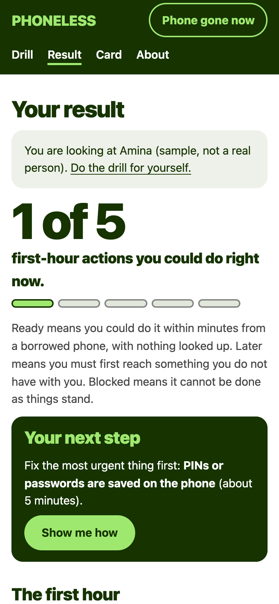
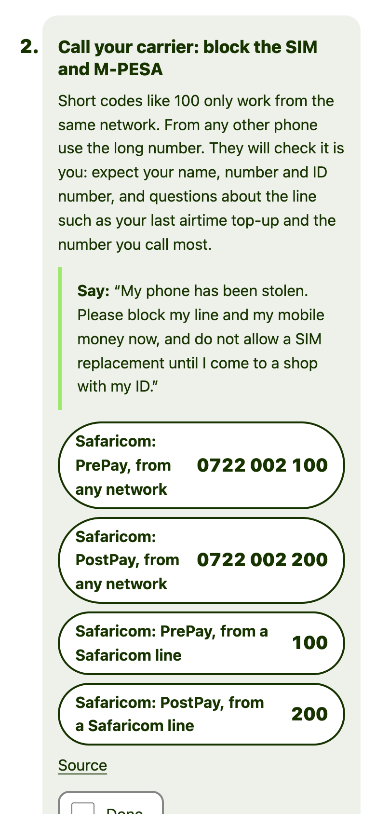
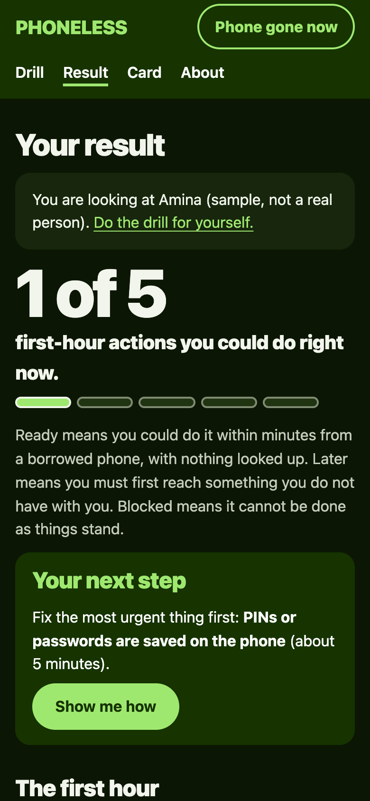
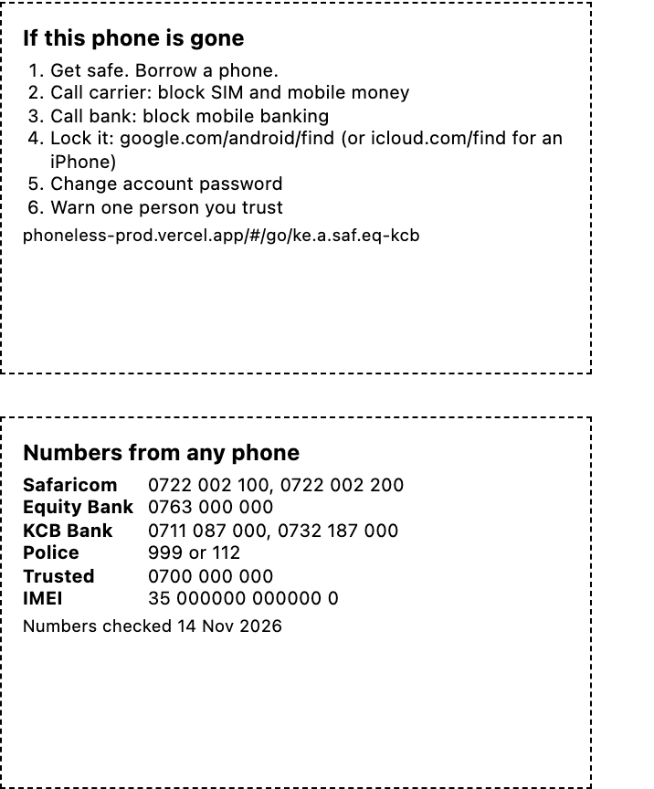
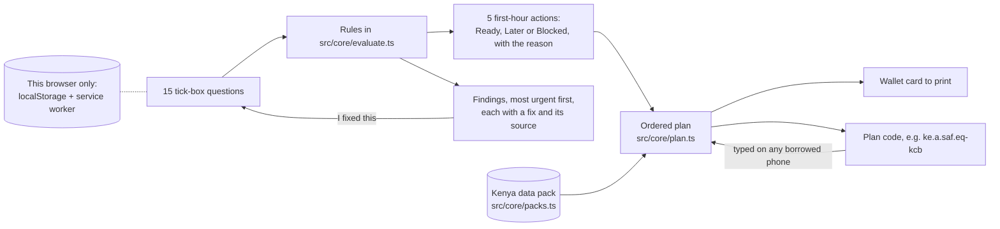

# Phoneless

**A two-minute drill for the day your phone is stolen.** Take it before anything happens: it shows which of five first-hour actions you could really do from a borrowed phone, helps you fix the ones you couldn't, and leaves you with a plan and a wallet card that are not on the phone.

**Try it:** https://phoneless-prod.vercel.app · No account, no server, nothing you answer leaves your device.

**Watch the demo (2:46):** https://youtu.be/GchgIZ0uaVg

<p>
  
  
  
</p>

## Contents

1. [The situation](#the-situation)
2. [Try it in two minutes](#try-it-in-two-minutes)
3. [One safer outcome](#one-safer-outcome)
4. [Demo video](#demo-video)
5. [How it works](#how-it-works)
6. [Where the numbers come from](#where-the-numbers-come-from)
7. [How it was tested](#how-it-was-tested)
8. [Limitations](#limitations)
9. [Privacy](#privacy)
10. [Run it locally](#run-it-locally)
11. [Built during the event, credits and AI assistance](#built-during-the-event-credits-and-ai-assistance)

## The situation

A university student in Nairobi has one phone. It holds their SIM, M-PESA, their bank app, their email and the codes that let them sign in. The phone is snatched in traffic. They are standing on the street with a borrowed phone, and every first step they could take — block the line, freeze the bank, lock the phone — needs a number, a password or a code that was on the stolen phone.

Phoneless is for that person, before it happens. It does not do anything for you on the day; it shows you now what you would be locked out of, so you can fix it while you still have the phone.

## Try it in two minutes

1. Open https://phoneless-prod.vercel.app and choose **Try with a sample person**. Amina (made up) can do **1 of 5** first-hour actions.
2. Read why the remote lock is blocked: the sign-in code goes to the stolen phone.
3. Choose **I fixed this** on each finding and watch the count reach **5 of 5**.
4. Open **Phone gone now** to see the ordered plan with numbers that work from any network.
5. Open **Card** to see the wallet card built from the drill, ready to print.
6. Turn your network off and reload. Everything still works.

## One safer outcome

The sample person starts able to do **1 of 5** first-hour actions: only "warn someone you trust" is ready. Remote lock and securing her Google Account are blocked, and blocking the SIM and freezing the bank have to wait until she finds the numbers.

After the **8 fixes** the drill suggests — about **30 minutes** in total by the app's own estimates — she can do **5 of 5**, and carries the plan on a card with the plan code `ke.a.saf.eq-kcb`.



The card above uses the made-up contact `0700 000 000` and IMEI `35 000000 000000 0`.

## Demo video

**[Watch on YouTube (2:46)](https://youtu.be/GchgIZ0uaVg)** · English captions included.

The video is a screen recording of the live site at phone size, with the sample person only. The borrowed-phone part is the same test browser with its storage cleared, not a second phone; the real "never opened it before" test was on a Samsung Galaxy A06 (see the [test log](docs/test-log.md)). The card in a wallet is a mockup: a screenshot of the real card on a stock photo.

<details>
<summary>Transcript</summary>

**Intro cards**

In January, Nairobi detectives found about nine hundred stolen phones in two parcels bound for Uganda. *(Capital FM, 26 Jan 2026, via [allAfrica](https://allafrica.com/stories/202601260159.html))*

INTERPOL says SIM-swap fraud in Kenya rose 327% in 2025. *(INTERPOL, [African Cyberthreat Assessment Report 2026](https://www.interpol.int/Media/Documents/Publications/Cybercrime/African-Cyberthreat-Assessment-Report-2026), which cites Safaricom's figures as reported by Capital FM)*

And one phone holds the SIM, M-PESA, the bank app and every sign-in code.

**The situation**

Your phone has just been snatched. Someone lends you theirs. Whose number do you know by heart? Can you even sign in to lock your phone? Most people find out on the street.

**The drill**

Phoneless is a two-minute drill you take before that day comes. Fifteen tick-box questions. It never asks for a PIN, a password or an ID number. This is Amina. She is made up.

**The result**

Amina could do one of the five first-hour actions today. Here is why she can't lock her phone. Locking it needs her Google sign-in. The sign-in sends a code. And the code goes to the phone that was stolen.

Each finding says why it matters, how to fix it, and where the steps come from. If one doesn't fit, she can set it aside. After eight fixes, about half an hour, she's at five of five.

**The wallet card**

Then she makes a wallet card, because the plan can't live only on the phone she might lose. Steps on the front, numbers that work from any network on the back. No ID number, no PIN, no password. Printed, it's the size of a bank card. This is a mockup on a stock photo.

**On a borrowed phone**

On a borrowed phone, she types the short code from the card. Her plan opens, in order, with the words to say and the numbers to tap. And on a phone that has opened it before, it still opens with the network off.

**Privacy and limits**

There is no server and no account, and nothing leaves the device. Every number shows its source and the date it was checked. It can't block anything for you, and it can be wrong. It doesn't replace your carrier, your bank or the police.

Phoneless. phoneless-prod.vercel.app

</details>

## How it works



**The five first-hour actions:** lock the phone remotely, block the SIM and mobile money, freeze bank apps and cards, secure your Google or Apple account, and warn someone you trust.

**The three states:**

- **Ready**: you could do it within minutes from a borrowed phone, with nothing looked up.
- **Later**: you must first reach something you do not have with you, such as a number that is only in the stolen phone.
- **Blocked**: it cannot be done as things stand, for example because the sign-in code goes to the stolen SIM.

**The plan** always starts with getting safe, then calling the carrier to block the SIM and mobile money. The remote lock comes next if it is ready, otherwise after the banks.

**The plan code** (for example `ke.a.saf.eq-kcb`) holds only the country, the phone type, the carriers and the banks. Typed after `#/go/` on any phone, it opens the same plan with the right numbers, even offline once the site has been opened.

**Stack:** Preact, Vite and TypeScript, hash routing, and a hand-written service worker. The whole app is about 26 KB gzipped; the build fails above 40 KB.

## Where the numbers come from

Every number was compared with the provider's own page on the date shown. All of them were read on the page itself.

| Provider | Numbers from any network | Source | Checked |
| --- | --- | --- | --- |
| Safaricom | 0722 002 100, 0722 002 200 | [safaricom.co.ke](https://safaricom.co.ke/about/contact-us) | 14 Nov 2026 |
| Airtel | 0733 100 100 | [airtelkenya.com](https://www.airtelkenya.com/ke/about/contact-us) | 21 Nov 2026 |
| Telkom | 020 222 1000 | [telkom.co.ke](https://telkom.co.ke/help-center/contact-us/) | 21 Nov 2026 |
| Equity Bank | 0763 000 000 | [equitel.com](https://equitel.com/secure-banking-tips) | 14 Nov 2026 |
| KCB Bank | 0711 087 000, 0732 187 000 | [ke.kcbgroup.com](https://ke.kcbgroup.com/talk-to-us) | 21 Nov 2026 |
| Co-operative Bank | 0703 027 000, 020 277 6000 | [co-opbank.co.ke](https://www.co-opbank.co.ke/contact) | 14 Nov 2026 |
| Absa Bank Kenya | 0722 130 120, 0732 130 120, 020 390 0000 | [absabank.co.ke](https://www.absabank.co.ke/talk-to-us/) | 21 Nov 2026 |
| NCBA Bank | 0800 720 444, 0711 056 444, 0732 156 444 | [ncbagroup.com](https://ncbagroup.com/ke/talk-to-us/) | 21 Nov 2026 |
| Stanbic Bank | 0711 068 888, 020 326 8888 | [stanbicbank.co.ke](https://www.stanbicbank.co.ke/kenya/personal/contact-us) | 21 Nov 2026 |
| Police emergency line | 999 or 112 | [National Police Service](https://nationalpolice.go.ke/sites/default/files/2025-01/NPS%20Service%20Standards.pdf) | 21 Nov 2026 |

The same table is rendered in the app's About page straight from `src/core/packs.ts`, so the two cannot disagree.

## How it was tested

Every run is logged with its date, device and version in [docs/test-log.md](docs/test-log.md). A row that failed or was not run stays there.

| Test | Device and version | Result |
| --- | --- | --- |
| Core logic, 48 unit tests | Node, Vitest | Pass |
| Whole loop in a browser, 24 checks, including the offline reload and "no request left this site" | Headless Chrome, playwright-core | Pass |
| Plan code on a phone that never opened the site, tap-to-call, copy link, offline after one visit | Samsung Galaxy A06, Android 16, Chrome 158 | Pass |
| Android settings steps followed on that phone | Samsung Galaxy A06, Android 16 | Two steps had the wrong menu names for Samsung; both fixed |
| Printed card, A4 at 100% | Mac, Chrome, HP DeskJet 2720 (printer for the current design not recorded) | Pass on the earlier and the current design: each face 85.6 × 54 mm, nothing cut off |
| TalkBack | Samsung Galaxy A06, Android 16, Chrome | Pass on the earlier and the current design: every number read with its provider |
| VoiceOver | macOS 27.0, Safari 27.0 | Pass on the earlier and the current design |
| Keyboard only, zoom to 400%, 320 px screen, contrast, colour removed | Chrome on a Mac, scripted | Pass after three fixes, and again on the current design |
| axe-core 4.14.1, seven screens, light and dark, two widths | Chrome on a Mac | 0 violations in 28 runs |
| Lighthouse 13.6.0, mobile, seven screens | Chrome on a Mac | Accessibility 100 and best practices 100 on all seven |
| Every sentence read aloud to people who are not developers | 7 people, in person | Nobody was confused |
| People taking the drill unaided | Testers' own phones | Every tester said the first design looked bad, so I redesigned it. Their scores were not recorded |

Automated tools like axe and Lighthouse find only some accessibility problems; they ran against a local build of the same code. Phoneless has not been tested in a real theft, on an iPhone, or by a real call to block a line.

## Limitations

- It cannot block, lock or erase anything. It tells you who to call and in what order.
- It only knows what you tick. If a setting is different from what you answered, the result will be wrong; any finding can be set aside.
- It has not been tested in a real theft.
- Numbers are for Kenya only: Safaricom, Airtel, Telkom and six banks. Anywhere else you get the plan without numbers.
- English only. No SACCOs or mobile lenders, and no QR code on the card.
- The order "call the carrier first, then lock the phone" follows advice from one person at a bank or phone shop in Kenya; it is not a rule stated on any page I found. Google says the phone must be online to be locked, so once the SIM is blocked the lock may arrive only over Wi-Fi.
- It is a student prototype. It does not replace the police, your carrier or your bank, or any emergency service.

## Privacy

Phoneless has no server and no accounts. Your answers are ticks, not secrets, and they are stored only in this browser until you erase them. The optional contact number and IMEI stay on this device and on the paper you print. A plan code holds your phone type, carriers and banks, and nothing else. Nothing is tracked, and no request leaves the site; the browser test fails if one does.

Phoneless never asks for a PIN, password or ID number. The only real address is **phoneless-prod.vercel.app**; a look-alike page asking for any secret is not Phoneless.

## Run it locally

Needs Node 22 or later and, for the browser test, Google Chrome.

```bash
npm install
npm run dev         # dev server, http://localhost:5173
npm test            # 48 unit tests on the core
npm run typecheck   # tsc --noEmit
npm run build       # type-check, build, write sw.js, print sizes, enforce the 40 KB gzip budget
npm run e2e         # build, then 24 checks in headless Chrome, including offline
npm run preview     # serve dist/ at http://localhost:4173
```

If `npm run e2e` cannot find Chrome, set `CHROME_PATH` to the Chrome binary.

## Built during the event, credits and AI assistance

**Built during the event.** Everything in this repository was built from 14 Nov 2026, inside both hackathons' submission windows. The first commit in this repository (16 Nov) holds only a one-line README. There is no pre-existing work.

**Libraries:** [Preact](https://preactjs.com), [Vite](https://vite.dev), [@preact/preset-vite](https://github.com/preactjs/preset-vite), [Vitest](https://vitest.dev) and [playwright-core](https://playwright.dev). No analytics, fonts or scripts from anywhere else.

**Data:** contact numbers from the official pages of Safaricom, Airtel, Telkom, Equity, KCB, Co-operative, Absa, NCBA and Stanbic, and the National Police Service (linked above). Device and account steps from Google, Apple and WhatsApp help pages. The design direction was inspired by the Wise style on [Refero Styles](https://styles.refero.design); no logos, fonts or artwork were copied.

**Video:** voice by me. The wallet in the mockup is [Wallet (AM 1969.3-5)](https://commons.wikimedia.org/wiki/File:Wallet_(AM_1969.3-5).jpg) by Auckland War Memorial Museum, [CC BY 4.0](https://creativecommons.org/licenses/by/4.0/), with the card added. The background piano was synthesised on my computer with an algorithmic music tool, with no samples. The intro figures come from Capital FM (via allAfrica) and INTERPOL, linked in the transcript.

**People and data:** the sample person, Amina, is made up. No real names, numbers or answers appear anywhere in Phoneless, its screenshots or its tests.

### AI assistance

Both hackathons ask for this, so here it is in full. I built Phoneless with Claude (Anthropic), used through Claude Code.

**What Claude did:**

1. Wrote some of the code: parts of the starter (core logic, build scripts and tests), then the wallet card, the About page and the fixes after my tests.
2. Re-checked the provider numbers against their official pages.
3. Ran the automated checks (unit tests, browser checks, axe, Lighthouse, the zoom, contrast and keyboard audit) and wrote them up in the test log.

**What I did:**

1. Researched the problem (phone theft and SIM swap in Kenya) and both hackathons' rules and judging criteria.
2. Designed the drill rules: the 15 questions, the five first-hour actions and the Ready / Later / Blocked logic.
3. Decided what Phoneless does and leaves out: no account, no server, and it never asks for a PIN, password or ID number.
4. Wrote some of the code: the first four screens in the starter, the Forest and lime redesign, and changes to the build scripts and tests.
5. Tested it on my own phone (Samsung Galaxy A06) and on paper: the plan code, tap-to-call, offline, the Android settings steps, TalkBack, VoiceOver and printing the card.
6. Called Safaricom to hear what they ask for, and asked someone at a bank or phone shop, which changed the plan to call the carrier first.
7. Read every sentence aloud to 7 people, ran the people test that led to the redesign, and picked the design direction.
8. Drafted this README, the commit messages and the pull request descriptions.
9. Reviewed and approved every change before it went live.

### Licence

[MIT](LICENSE). Made by Gregory Temwa Odete.
